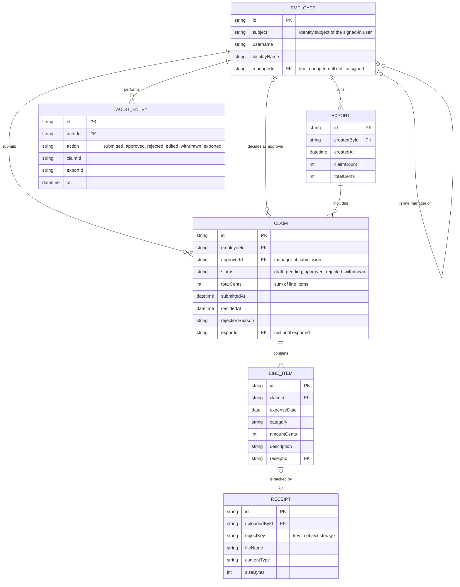

# Domain model

Employees submit claims made of line items with receipts; each claim goes to the employee's line manager, and approved claims are gathered into payroll exports. Every action is written to an audit log.

Amounts are integers in cents in one company currency. A receipt's bytes live in object storage; the database holds only its key and metadata.